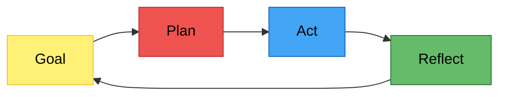
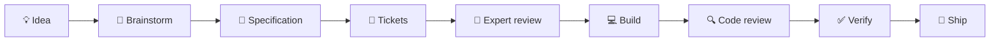

# Getting Started: Building Mobile Apps with an AI Coding Agent

> [!NOTE]
> This document is written for people who are **not (yet) software developers** but want to build a mobile app with the help of an AI coding agent such as Claude Code. It summarises the ideas from [Part 1](https://github.com/evermeer/CodingAgentOrchestration/blob/main/docs/part-1-why-use-an-ai-coding-agent-cli.md) and [Part 2](https://github.com/evermeer/CodingAgentOrchestration/blob/main/docs/part-2-how-to-use-an-ai-coding-agent.md) of the guide [Coding Agent Orchestration](https://github.com/evermeer/CodingAgentOrchestration) in plain language, and then walks you through everything you need to get started: the tools on your computer, Claude Code itself, the Firebase backend services and the app store accounts.

## Contents

1. [What is an AI coding agent and why use one?](#1-what-is-an-ai-coding-agent-and-why-use-one)
2. [How to work with an AI coding agent](#2-how-to-work-with-an-ai-coding-agent)
3. [Setting up your mobile development environment](#3-setting-up-your-mobile-development-environment)
4. [Installing and configuring Claude Code](#4-installing-and-configuring-claude-code)
5. [Firebase: the backend for your app](#5-firebase-the-backend-for-your-app)
6. [App store developer accounts](#6-app-store-developer-accounts)

---

## 1. What is an AI coding agent and why use one?

*A non-technical summary of [Part 1: Why Use an AI Coding Agent CLI?](https://github.com/evermeer/CodingAgentOrchestration/blob/main/docs/part-1-why-use-an-ai-coding-agent-cli.md)*

### From chatbot to digital colleague

Most people first meet AI through a chat website: you ask a question, you get an answer. That is useful, but the AI doesn't know anything about your project and can't do anything for you — you still have to copy, paste and try things yourself.

Over the last few years AI help for software has grown step by step:

1. **Chatting on a website** — ask questions, get answers.
2. **Autocomplete while typing** — the AI suggests the next line, like predictive text on your phone.
3. **Asking about a piece of code** — select something and ask the AI to explain or change it.
4. **A chat panel next to your code** — the AI can see the file you are working on.
5. **An agent inside the code editor** — the AI can change multiple files and check its own work.
6. **A standalone agent (like Claude Code)** — the AI can also run programs, install tools, run tests and work for a longer time on its own.

Each step doesn't replace the previous one; it simply increases the size of the task you can hand over. This document focuses on step 6.

### How an agent works: the loop

The big difference between a chatbot and an agent is that an agent works in a loop, much like a person would:



- **Goal** — what you asked for ("add a login screen").
- **Plan** — the agent figures out which steps are needed.
- **Act** — it writes code, runs commands, creates files.
- **Reflect** — it checks the result (does it build? do the tests pass?) and decides what to do next.

### Context is everything

An AI is only as good as the information it has. Think of it as a very capable new colleague on their first day: brilliant, but they don't know your project, your preferences or your decisions yet. The better you inform them, the better the result. But dumping *everything* on them slows them down and distracts them.

In practice you give the agent context in a few ways:

- **How to behave** — "skills" that teach the agent a way of working (for example: always write a plan first).
- **What the project is about** — a description file in your project, or tools that build a map of your code and documents.
- **Outside information** — connections to other systems (your task board, documentation, databases).
- **What was decided before** — a memory of earlier sessions, so you don't have to repeat yourself.

Leaving out irrelevant information is just as important as adding the right information.

### When an agent is *not* the right tool

An agent is not always the best choice. Doing it yourself or asking a simple chat question is often better when:

- the change is tiny and you can do it faster yourself;
- checking the agent's work would take longer than doing it yourself;
- it involves sensitive or live (production) systems you don't want an AI touching;
- you don't know yet what you actually want.

### What makes the results better

The quality of what the agent produces depends on several "layers" you can improve:

| Layer | In plain language |
| --- | --- |
| **Prompt** | What you ask and how clearly you ask it. Asking the agent to first repeat the task, list its assumptions and propose a plan works much better than "just build it". |
| **Language servers (LSP)** | Helpers that let the agent understand code structure precisely, instead of just reading it as text. |
| **Plugins** | Add-ons that change how the agent works, for example by forcing planning steps or keeping its memory clean. |
| **Connectors (MCP)** | Connections to outside systems like documentation sites, task boards or Firebase. |
| **Project settings** | A file in your project that tells the agent the rules and conventions, so you don't have to repeat them every session. |
| **Skills** | Reusable "recipes" for recurring work, like writing a specification or reviewing code. |
| **Tools** | Extra programs the agent can use, for example to create documents or presentations. |
| **The AI model** | The "brain" itself. Different models are better at different things, and new ones appear every few months. |

---

## 2. How to work with an AI coding agent

*A non-technical summary of [Part 2: How to Use an AI Coding Agent](https://github.com/evermeer/CodingAgentOrchestration/blob/main/docs/part-2-how-to-use-an-ai-coding-agent.md)*

### Four skill packs that complement each other

A "skill pack" is a collection of ready-made recipes for the agent. The guide recommends four packs that each cover a different question and hardly overlap:

| Skill pack | Answers the question | Examples |
| --- | --- | --- |
| **Superpowers** | *How* should the work be done? | brainstorming, planning, test-first development, systematic debugging, verifying before calling something done |
| **Matt's Skills** | *What* needs to be done? | writing specifications, splitting work into tickets, code reviews, research |
| **Agency Agents** | *Who* should look at it? | virtual specialists: architect, security expert, product manager, UX designer |
| **Knowledge Work plugins** | *Where* in the organisation? | engineering, product, marketing, finance, support |

### The workflow: from idea to app store

The core idea is simple: **don't let the agent start building right away.** First make the idea clear, then make a plan, then build in small steps, and check everything along the way. It is exactly how a good software team works — the agent just plays most of the roles.



| Step | What happens | What you do |
| --- | --- | --- |
| 💡 **Idea** | You write down your idea in plain language in a text file: what you want and *why*. | Write a few paragraphs. Let the agent ask you questions until everything is clear. |
| 🧠 **Brainstorm** | The agent explores different ways to realise the idea, with pros and cons. | Discuss, push back, choose a direction. |
| 📝 **Specification** | The chosen direction is turned into a precise description: what's in, what's out, and when it counts as "done". | Read it carefully and correct wrong assumptions. |
| 🎫 **Tickets** | The specification is cut into small pieces of work that can each be built and tested separately. | Check that the order makes sense. |
| 👥 **Expert review** | Virtual specialists (architect, security, product) review the plan and raise concerns *before* anything is built. | Decide which advice to follow. |
| 💻 **Build** | The agent builds one ticket at a time, tests it and saves the result. | Try out what has been built and give feedback. |
| 🔍 **Code review** | The agent reviews its own work for mistakes, security issues and sloppiness. | Let it fix what it found. |
| ✅ **Verify** | A final check: does everything really work as described in the specification? | Only accept "done" when there is proof. |
| 🚢 **Ship** | The app is released, monitored and lessons learned become the next idea. | Publish, watch, learn. |

A useful habit throughout: **let the agent write every decision into a "decisions" file.** That way you (and the agent, in a later session) always know why things are the way they are.

Some optional steps you can add whenever they help:

- 🔥 **Grill me** — let the agent critically question your idea to find weak spots before you build.
- 🏛️ **Engineering council** — get several independent expert opinions on a difficult choice, combined into one recommendation.
- 🐛 **Debugging** — when something breaks, let the agent search for the real cause instead of patching symptoms.
- 📚 **Documentation** — keep the descriptions of your app up to date after each change.

> [!TIP]
> After every step, **read what the agent produced and ask questions**. You are the product owner: the agent does the work, but you make the decisions.

> [!NOTE]
> This exact workflow was used to create the game [Quadrim](https://evict.nl/quadrim) ([iOS](https://apps.apple.com/nl/app/quadrim/id6804034367), Android soon) — a 3D four-in-a-row strategy game with multiple opponents, rating system and in-app purchases. It took about 4 weeks of spare time from idea to the app stores.

---

## 3. Setting up your mobile development environment

To build an app you need a few programs on your computer. We use **Flutter**, a free toolkit from Google that lets you build **one app that runs on both Android and iPhone**. This means you (and the agent) only have to write the app once.

Here is what you will install and why:

| Program | What it is | Why you need it |
| --- | --- | --- |
| **Git** | A "time machine" for your project files. Every change is saved as a version you can go back to. | Protects you against mistakes (by you or the agent) and is required by Claude Code on Windows. |
| **Flutter** | The toolkit to build the app. | This is what the app is made with. |
| **Android Studio** | Google's program for Android development. | Provides the Android tools and a virtual phone (emulator) to test your app on. |
| **Xcode** *(Mac only)* | Apple's program for iPhone development. | Required to build and publish iPhone apps. |

> [!TIP]
> Once Claude Code is installed (section 4), you can also ask it to install and check these tools for you. It is still good to know what each one does.

### 3.1 Git

1. Download **Git for Windows** from [git-scm.com/download/win](https://git-scm.com/download/win) and run the installer. The default options are fine.
2. Open a terminal (search for "Terminal" or "PowerShell" in the Start menu) and check the installation:
   ```bash
   git --version
   ```
3. Tell Git who you are (used to label your saved versions):
   ```bash
   git config --global user.name "Your Name"
   ```
   ```bash
   git config --global user.email "you@example.com"
   ```
4. Recommended: create a free account on [GitHub](https://github.com). This gives you an online backup of your project and makes it easy to share it with others.

### 3.2 Flutter

1. Follow the official Windows install guide at [docs.flutter.dev/get-started/install/windows](https://docs.flutter.dev/get-started/install/windows) and choose **Android** as the target.
2. Put Flutter in a simple folder such as `C:\src\flutter`. **Do not** put it in `C:\Program Files` — Flutter needs to be able to write in its own folder.
3. Make sure Flutter is added to your `PATH` (the install guide explains this; it means Windows can find the `flutter` command from any folder).
4. Windows may ask you to turn on **Developer Mode** (Settings → System → For developers). Flutter needs this for some plugins.
5. Check your installation:
   ```bash
   flutter doctor
   ```
   `flutter doctor` is a checklist that tells you what is still missing. Don't worry if it complains about Android at this point — that is the next step. You can ignore the "Visual Studio" item; that is only needed for building Windows desktop apps.

### 3.3 Android Studio

1. Download and install Android Studio from [developer.android.com/studio](https://developer.android.com/studio).
2. Start it and follow the setup wizard with the **Standard** options. It will download the Android SDK (the Android building blocks).
3. In Android Studio go to **Settings → Plugins** and install the **Flutter** plugin (it will also install the **Dart** plugin, the programming language Flutter uses).
4. Go to **Settings → Languages & Frameworks → Android SDK → SDK Tools** and tick **Android SDK Command-line Tools**.
5. Accept the Android licences:
   ```bash
   flutter doctor --android-licenses
   ```
6. Create a virtual phone: **Device Manager → Create Virtual Device**, pick a recent phone model and system image.
7. Optional but nice: test on your own Android phone. Enable *Developer options* (tap "Build number" 7 times in the phone's settings), turn on *USB debugging* and connect it with a cable.
8. Run `flutter doctor` again. When the Flutter and Android items show a green check mark, you are ready to build Android apps.

### 3.4 iPhone apps: you need a Mac

> [!IMPORTANT]
> **iPhone (iOS) apps can only be built, signed and published from a Mac with Xcode.** Apple does not offer Xcode for Windows. On your Windows computer you can build and test the Android version of your app, and because Flutter uses one codebase, most of your work carries over directly to the iPhone version.

When you want to release on the Apple App Store you will need:

- **A Mac** (any reasonably recent Mac, such as a Mac mini, is enough) with the latest macOS.
- **Xcode**, free from the Mac App Store. After installing, open it once to finish the setup and install the iOS simulator.
- **Flutter** installed on the Mac as well (and **Git**, to get your project from GitHub onto the Mac).
- An **Apple Developer Program** membership to publish (see [section 6](#6-app-store-developer-accounts)).

Alternatives if you don't want to buy a Mac right away: rent a Mac in the cloud (for example MacinCloud) or use a build service such as Codemagic that builds iOS apps for you on their Macs. For testing and fixing iPhone-specific problems a real Mac is still by far the most convenient option.

---

## 4. Installing and configuring Claude Code

*A rewritten version of [Installation, setup and configuration of Claude Code](https://github.com/evermeer/CodingAgentOrchestration/blob/main/docs/claude-code-install-mobile.md), with extra explanation.*

**Claude Code** is Anthropic's AI coding agent. It can read your project, write code, run commands (like `flutter doctor` or building your app) and follow the workflow from section 2. You need a paid Claude subscription (Pro or Max) to use it.

> [!NOTE]
> Install **Git** first (section 3.1). Claude Code on Windows uses Git's command-line environment behind the scenes.

### 4.1 The main software

Go to [claude.ai/downloads](https://claude.ai/downloads). There are several ways to use Claude; they all share the same account, so you can mix and match:

| Download | What it is | Recommended for you? |
| --- | --- | --- |
| **Desktop app** | A normal Windows application. The **Code** tab is Claude Code with a friendly interface: chat, see changed files, preview, manage multiple sessions. | ✅ Yes — the easiest place to start. |
| **Terminal (CLI)** | Claude Code in a text-only command window. The same power, fewer buttons. | ✅ Yes — some plugins are installed from here and some guides assume it. |
| **VS Code extension** | Claude Code inside VS Code, a popular free code editor. Handy to look at the code the agent writes. | 👍 Recommended. |
| **Chrome extension** | Lets Claude use your web browser, for example to test web pages or look things up. | Optional. |
| **JetBrains extension** | Same as VS Code, but for JetBrains editors (Android Studio is built on JetBrains). | Optional — useful if you prefer working inside Android Studio. |

### 4.2 Connectors and plugins

Claude Code can be extended in two ways:

- **Connectors** connect Claude to *outside* information and systems — like giving your colleague access to a library or a company system.
- **Plugins** add *skills and behaviour* — like giving your colleague training and work habits.

In the Claude desktop app go to **Customize → Connectors** and **Customize → Plugins** and browse the library. Another good source of plugins is the [Claude Plugin Hub](https://www.claudepluginhub.com/).

> [!TIP]
> Every enabled connector and plugin costs a little extra time and usage, because Claude has to "know" about it. If you are unsure whether you will use one, install it but **disable** it until you need it.

**Recommended connectors**

| Connector | What it does for you |
| --- | --- |
| **Context7** | Gives Claude up-to-date documentation of libraries and tools (such as Flutter and Firebase), so it doesn't rely on outdated knowledge. |
| **Exa** | Lets Claude search the web for answers and examples. |
| **Microsoft Learn** | Official Microsoft documentation (useful for Windows questions). |
| **Claude in Chrome** | Lets Claude look at and interact with web pages in your Chrome browser. |
| **Filesystem** | Lets Claude read and write files in folders you allow. |

**Recommended plugins**

For the plugins that come from GitHub, open the link and follow the instructions for **Claude Code** in that project's README. Or simply paste the link into Claude Code and ask it to install the plugin for you.

| Plugin | What it does for you |
| --- | --- |
| **Engineering** | Standard skills for software work: code review, debugging, documentation, architecture. |
| **Data** | Skills for analysing data and making charts. |
| [**cc-safety-net**](https://github.com/kenryu42/cc-safety-net) | A safety net that blocks dangerous commands (like deleting files permanently) before they run. Highly recommended for beginners. |
| [**graphify**](https://github.com/safishamsi/graphify) | Builds a "map" of your project so Claude understands how everything is connected. |
| [**mempalace**](https://github.com/MemPalace/mempalace) | Gives Claude a long-term memory across sessions. |
| [**context-mode**](https://github.com/mksglu/context-mode) | Keeps Claude's working memory clean by not loading large outputs into the conversation. |
| [**context-optimizer**](https://github.com/evermeer/context-optimizer) | Removes duplicate and irrelevant information before it is sent to the AI — faster and cheaper. |
| [**Superpowers**](https://github.com/obra/superpowers) | The *how* skill pack from section 2: brainstorming, planning, debugging, verification. |
| [**Skills for real engineers**](https://github.com/mattpocock/skills) | Matt's *what* skill pack from section 2: specifications, tickets, reviews. |
| [**Agency Agents**](https://agencyagents.app/) | The *who* pack from section 2: virtual specialists. Install the app and add the skills from there ([source code](https://github.com/msitarzewski/agency-agents-app)). |
| [**gstack**](https://github.com/garrytan/gstack) | A set of product and engineering workflows: planning reviews, QA testing, shipping. |
| [**Ponytail**](https://github.com/DietrichGebert/ponytail) | Makes Claude prefer simple solutions over over-engineered ones — less code, fewer bugs. |

**Optional plugins** that can be interesting later: *Design*, *Customer Support*, *Enterprise Search*, *Marketing* (useful for your app store listing and launch) and *Product Management*.

**Useful extras for mobile development**

- **Dart and Flutter MCP server** — lets Claude inspect your running Flutter app, find packages and fix errors. Part of the Dart SDK that comes with Flutter; see [dart.dev/tools/mcp-server](https://dart.dev/tools/mcp-server).
- **Firebase MCP server** — lets Claude work with your Firebase project (section 5) directly. See [firebase.google.com/docs/ai-assistance/mcp-server](https://firebase.google.com/docs/ai-assistance/mcp-server).

### 4.3 Language servers (LSPs)

A language server is a helper that understands a programming language precisely: where something is defined, where it is used, and which errors there are. With it, Claude navigates your code like an experienced developer instead of guessing from plain text. For a Flutter app, **Dart** is the one that matters most; the others are useful for Firebase Cloud Functions (TypeScript/JavaScript or Python) and configuration files (YAML).

You don't have to install these by hand. Paste this prompt into Claude Code:

```text
Install and configure LSPs for:

- Dart
- TypeScript/JavaScript
- Python
- YAML
- C#

Detect my operating system, install the appropriate language servers, verify they're working, and update my Claude Code configuration if needed.
Afterwards show me:
1. what was installed
2. where it was installed
3. how to verify each LSP is working
```

---

## 5. Firebase: the backend for your app

Most apps need more than what runs on the phone: user accounts, data that is shared between devices, notifications, and insight into how the app is used. **Firebase** is Google's platform that provides all of this as ready-made services, so you don't have to build and maintain your own servers. It works very well with Flutter through the official **FlutterFire** packages, and a single command (`flutterfire configure`) connects your app to your Firebase project.

Firebase has a free **Spark** plan and a pay-as-you-go **Blaze** plan. Several services below (Cloud Functions, and Cloud Storage for new projects) require Blaze, but the free allowance included in Blaze is generous enough that a small app often costs little or nothing. **Always set a budget alert** in the Google Cloud console when you switch to Blaze.

### Cloud Messaging (push notifications)
**Firebase Cloud Messaging (FCM)** sends push notifications to your users' phones — "It's your turn!", "Your order has shipped" — even when the app is closed. It works for both Android and iPhone (for iPhone you upload an Apple push key from your Apple Developer account once). You can send messages manually from the Firebase console, for example for announcements, or automatically from Cloud Functions when something happens in your app. FCM itself is free.

### Firestore (database)
**Cloud Firestore** is the central database for your app's data: user profiles, scores, messages, settings. Data is stored as "documents" in "collections" (think of folders with index cards) and is synchronised in real time, so when something changes on one phone, other phones see it immediately. It also keeps working when the phone is temporarily offline. Access is controlled with **security rules** — make sure you (or Claude) set these up properly, because they decide who may read and change which data.

### Cloud Storage (files)
**Cloud Storage for Firebase** stores files such as photos, videos, audio and other large content that doesn't fit in a database. A typical pattern is that the file is stored in Cloud Storage and a reference to it is saved in Firestore. Like Firestore, it is protected by security rules, so users can only access the files they are allowed to see.

### Cloud Functions (server-side logic)
**Cloud Functions** are small pieces of code that run on Google's servers instead of on the phone. Use them for anything that should not be done or trusted on a user's device: validating in-app purchases, calculating rankings, sending a notification when another player makes a move, cleaning up data, or talking to other services with secret keys. They run automatically when something happens (a new document in Firestore, a new user, a schedule) and you only pay for the time they run. They are written in TypeScript/JavaScript or Python and require the Blaze plan.

### Authentication (user management)
**Firebase Authentication** handles signing up and logging in, which is surprisingly hard to do securely yourself. It supports email and password, phone numbers, and sign-in with Google, Apple and others. Note that the Apple App Store requires **Sign in with Apple** if your app offers other social logins such as Google, and both stores require that users can **delete their account** from within the app if they can create one.

### Analytics
**Google Analytics for Firebase** shows how people use your app: how many users you have, where they come from, which screens they visit, how long they stay and where they drop off. You can log your own events (for example "level completed" or "purchase made") to understand what works. It is free. Remember to mention analytics in your privacy policy and in the privacy sections of both app stores.

### Crashlytics
**Firebase Crashlytics** automatically reports when your app crashes on a user's phone, including which device, which OS version and exactly where in the code it happened. It groups similar crashes and shows which ones affect the most users, so you know what to fix first. You can give a Crashlytics report straight to Claude Code and ask it to find and fix the cause. It is free.

---

## 6. App store developer accounts

To publish your app you need a developer account with each store. Create them **early**: verification can take from a few days to a few weeks.

| | 🍎 Apple App Store | 🤖 Google Play |
| --- | --- | --- |
| **Programme** | [Apple Developer Program](https://developer.apple.com/programs/) | [Google Play Console](https://play.google.com/console) |
| **Cost** | US$99 (€99) **per year** | US$25 **one-time** |
| **Account types** | Individual (your own name shown as seller) or Organisation (company name shown, requires a **D-U-N-S number**, which is free but can take a couple of weeks to obtain) | Personal or Organisation (organisation also requires a **D-U-N-S number**) |
| **Verification** | Apple ID with two-factor authentication; identity check | Government ID verification; organisations also verify their business details and website |
| **Testing** | **TestFlight** for testing with up to 10,000 testers | Internal, closed and open testing tracks. **New personal accounts must run a closed test with at least 12 testers for 14 consecutive days** before they can publish to everyone. |
| **Review** | Every release is reviewed by Apple, usually within 1–2 days | Reviews are usually quick, but the first release can take up to a week |
| **Required for publishing** | App Store Connect listing, screenshots, privacy policy URL, "App Privacy" questionnaire, a Mac with Xcode to upload | Store listing, screenshots, privacy policy URL, "Data safety" form, content rating questionnaire |

Both stores take a commission on in-app purchases and paid apps: normally **30%**, reduced to **15%** for small developers (Apple Small Business Program, and Google's 15% rate on the first US$1M revenue per year). On Apple you have to enrol in the Small Business Program yourself.

---

> [!NOTE]
> Want to dive deeper? Continue with the full guide: [Part 1](https://github.com/evermeer/CodingAgentOrchestration/blob/main/docs/part-1-why-use-an-ai-coding-agent-cli.md), [Part 2](https://github.com/evermeer/CodingAgentOrchestration/blob/main/docs/part-2-how-to-use-an-ai-coding-agent.md) and the [Claude Code installation guide](https://github.com/evermeer/CodingAgentOrchestration/blob/main/docs/claude-code-install.md).
